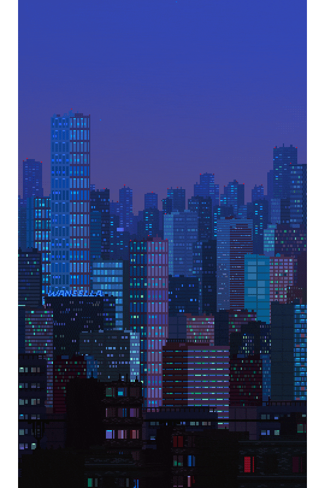
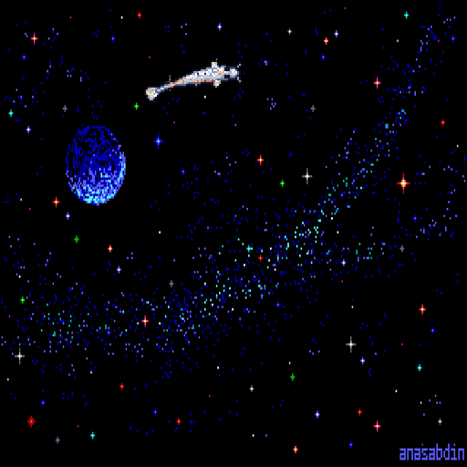
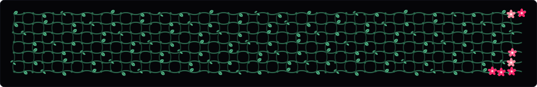

#### INDEX

<table>
  <tr>
    <td align="left" width="60%" valign="top">
      <b>MCSTARK07 // LOG</b>  
      
        first-year cs undergrad at iiit bhagalpur. mostly writing c++ and java, or messing around with backend systems and computer vision when i should probably be sleeping.  
        <b>stack:</b> c, c++, java, python, kotlin, react 
        <b>exploring:</b> opencv, pytorch, app dev 
        <b>current:</b> building generative art and other cool stuff 
        <b>reach:</b> niravrabaral07@gmail.com
      
    </td>
    <td align="center" width="40%" valign="middle">
      
    </td>
  </tr>
</table>

 

#### TELEMETRY

<table>
  <tr>
    <td rowspan="2" align="center" width="38%" valign="middle">
      <b>NIGHT CITY</b>  
      
    </td>
    <td align="center" width="62%">
      <b>SPACE KOI</b>  
      
    </td>
  </tr>
  <tr>
    <td align="center" width="62%">
      <b>SAKURA BLOOM</b>  
      
    </td>
  </tr>
</table>
